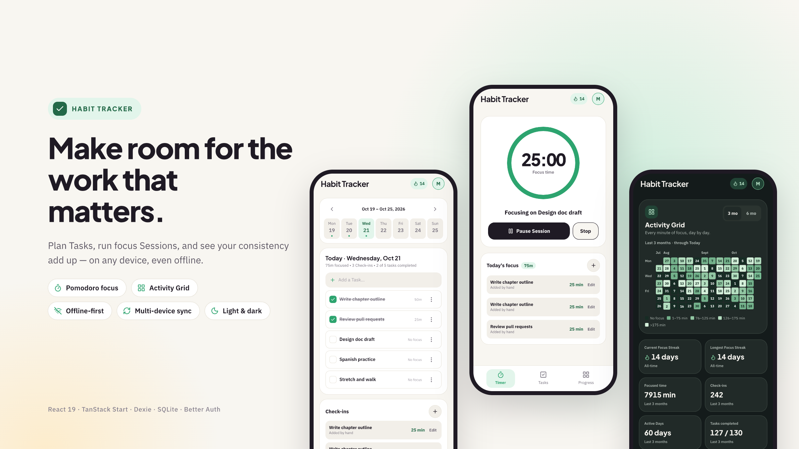
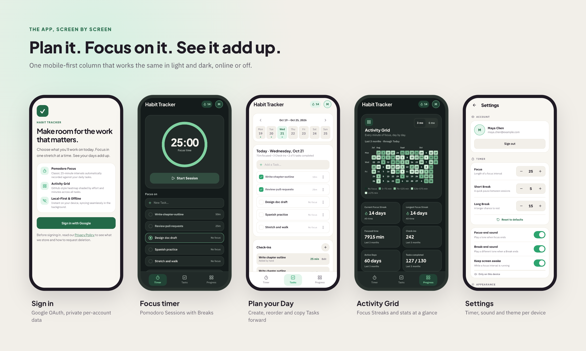

<div align="center">



<br />
<br />

# Habit Tracker

**Plan Tasks, run focus Sessions, and see your consistency add up — on any device, even offline.**

[](https://github.com/indraarianggi/habit-tracker/actions/workflows/deploy.yml)


[**Open the live app**](https://habits.indraarianggi.xyz) · [Features](#features) · [Getting started](#getting-started) · [Architecture](#architecture) · [Deployment](#deployment)

</div>

---

## Overview

Habit Tracker is a local-first, server-synced Pomodoro and task app. You choose the concrete Tasks you'll work on for a Day, run timed focus Sessions against them, and watch your history build up in a GitHub-style Activity Grid.

Everything you do is written to IndexedDB first, so the app stays instant and fully usable offline. Changes sync to a shared SQLite backend in the background, which is what lets the same account follow you from phone to laptop. Each User signs in with Google and only ever sees their own data.

It is built mobile-first as an installable PWA, with light and dark themes, and is self-hosted on a single homelab node with continuous off-site backups.

> The domain vocabulary (User, Task, Check-in, Pomodoro Session, Break, Day, Focus Streak, …) is defined once in [`CONTEXT.md`](./CONTEXT.md). Read it before touching domain logic.

## Screenshots



## Features

- **Focus** — Pomodoro Sessions with short and long Breaks, Wake Lock, sound alerts, and recovery after the tab sleeps or closes mid-session.
- **Today** — create, edit, complete, reorder and delete Tasks for Today or a future Day; copy unfinished work forward without moving the original.
- **Check-ins** — add, edit, reassign or delete focused-time records by hand; a Check-in always inherits its Task's Day.
- **Progress** — an accessible Activity Grid (Monday-start weeks, 3/6-month views, keyboard and touch navigation, contrast-checked in light and dark), all-time Focus Streaks, and a Day panel to inspect or amend history.
- **Offline and installable** — a service-worker shell precaches the app and privacy policy. Install prompts and version updates never interrupt a running focus interval.
- **Multi-device sync** — offline work, failed-sync backoff, sign-out with Pending changes, and expired-session resumption all keep this device's data intact, with conflicts converging deterministically.
- **Settings** — Pomodoro durations sync across devices; sound, Wake Lock and theme (System, Light, Dark) stay per-device.
- **Account deletion** — an online-only, typed-confirmation Danger Zone that atomically removes a User's data and propagates to every signed-in device.
- **Private by design** — Google sign-in via Better Auth, strict per-User data isolation, per-IP and per-User rate limiting, and a public privacy policy.

## Tech stack

| Layer | Choice |
|---|---|
| Framework | [TanStack Start](https://tanstack.com/start) + [TanStack Router](https://tanstack.com/router) on React 19, file-based routes in `src/routes/` |
| UI | Tailwind CSS v4 design tokens + locally owned [shadcn/ui](https://ui.shadcn.com) primitives, Plus Jakarta Sans and IBM Plex Sans |
| Client storage | [Dexie](https://dexie.org/) (IndexedDB), hand-rolled service worker |
| Auth | [Better Auth](https://www.better-auth.com/) with Google OAuth |
| Server storage | `better-sqlite3` (WAL), migrated in-process at startup |
| Validation | [Zod](https://zod.dev) contracts shared by client and server |
| Testing | [Playwright](https://playwright.dev/) for both browser journeys and headless server/multi-device checks |
| Delivery | Docker image on GHCR, GitHub Actions, Litestream replication |

## Getting started

### Prerequisites

Node 22.12+ and pnpm 11.20.0 (both pinned in `package.json`).

### Install

```sh
pnpm install --frozen-lockfile
cp .env.example .env.local
```

`.env.local` is read by the dev, build and start scripts. Real process environment variables take precedence, and only `.env.example` is tracked in git.

### Configure the environment

| Variable | Required for | Notes |
|---|---|---|
| `VITE_PRIVACY_CONTACT_EMAIL` | dev, build | A real, monitored inbox. Shown publicly on `/privacy` and bundled at **build time** — runtime changes don't affect already-built assets. |
| `BETTER_AUTH_URL` | live Google sign-in | The exact app origin, no trailing slash (use `http://127.0.0.1:3000` if you browse there). |
| `BETTER_AUTH_SECRET` | live Google sign-in | Random string, 32+ characters. Keep it stable across restarts. |
| `GOOGLE_CLIENT_ID` / `GOOGLE_CLIENT_SECRET` | live Google sign-in | From the OAuth client below. Never prefix secrets with `VITE_` — that exposes them to the browser. |
| `DATABASE_PATH` | optional | Writable, persistent SQLite path. Defaults to `.data/habit-tracker.sqlite`; the parent directory is created automatically. |

### Google sign-in

Create a Google OAuth **web** client per origin (local and public):

1. Authorized JavaScript origin: your app origin.
2. Authorized redirect URI: `http://localhost:3000/api/auth/callback/google` (local) or `https://<app-domain>/api/auth/callback/google` (public).
3. Set `GOOGLE_CLIENT_ID` and `GOOGLE_CLIENT_SECRET` to that client's values.

The Playwright suite stubs the Google consent screen and injects real Better Auth test sessions, so it never contacts Google. Completing a **live** consent flow needs your own OAuth credentials; no example credentials are committed.

### Run it

```sh
pnpm run dev          # http://localhost:3000
```

## Scripts

| Command | Does |
|---|---|
| `pnpm run dev` | Development server on `http://localhost:3000`. |
| `pnpm run build` | Production build. Requires `VITE_PRIVACY_CONTACT_EMAIL` at build time. |
| `pnpm run start` | Serve that build on port 3000 (`PORT` overrides). |
| `pnpm run typecheck` | `tsc --noEmit`, after the router generates `src/routeTree.gen.ts`. |
| `pnpm exec playwright install chromium` | One-time browser install for the test suite. |
| `pnpm run smoke:browser` | Full Playwright suite: browser journeys (offline/reconnect, sign-in expiry, sync recovery, sign-out with Pending changes, account switching, account deletion, PWA install/update) plus headless multi-device and server checks (sync isolation, conflict convergence, focus/session state). |
| `SMOKE_SERVER=production pnpm run smoke:browser` | Same suite against a previously built server (`pnpm run build` first). Needed for the PWA tests that only exercise meaningfully against real per-route SSR. |

The test runner owns port 3000 and supplies its own OAuth config, privacy contact and isolated SQLite data, so stop any other local server on that port first.

## Testing

Tests are colocated Playwright specs in `__tests__/*.test.ts` next to the routes or modules they cover (see [`docs/agents/testing.md`](./docs/agents/testing.md)), and the router ignores those folders when generating routes. Before opening a PR:

```sh
pnpm run typecheck && pnpm run smoke:browser
SMOKE_SERVER=production pnpm run smoke:browser   # for PWA-affecting changes
```

CI runs both server modes on every push and pull request.

## Architecture

- **Offline-first sync.** Tasks, Check-ins, Session state and Settings are created and edited in IndexedDB first, then pushed through `POST /api/sync/push` and `GET /api/sync/pull`, scoped to the signed-in User. Conflicts resolve last-write-wins in server-received order, with deletions beating stale edits.
- **Sync recovery.** The header hides sync status when current. Failed pushes back off exponentially (capped at five minutes) and retry immediately on reconnect, on returning to the app, or via "Sync now." An expired sign-in keeps local data readable and editable, and signing back into the same account uploads its Pending changes.
- **Account deletion.** The Danger Zone is online-only and requires typing `DELETE`. The server tombstones and atomically cascades the delete, and every other signed-in device recognizes "account gone" (HTTP 410) distinctly from an ordinary expired session (401) on its next sync.
- **Offline shell.** A hand-rolled service worker (`public/sw.js`) precaches the shell, `/today` and `/privacy`. Updates wait for user consent and are gated off while a focus interval is running or paused.

The reasoning behind these choices is recorded in [`docs/adr/`](./docs/adr/).

### Project structure

```
src/
  routes/        file-based routes (TanStack Router): today.tsx, privacy.tsx, api/*
  components/    screen-level React components + shadcn/ui primitives (components/ui/)
  lib/           client stores, sync clients, contracts shared with the server
  server/        SQLite access, migrations, auth config, account deletion
docs/
  adr/           architecture decisions (sync design, hosting)
  agents/        conventions for AI coding agents working in this repo
  assets/        README showcase images
.scratch/        feature specs and per-ticket implementation status
```

## Deployment

The production app runs at **[habits.indraarianggi.xyz](https://habits.indraarianggi.xyz)** on a single homelab node, reached through a Cloudflare Tunnel and a shared Caddy edge proxy. The design and its trade-offs are in [ADR-0002](./docs/adr/0002-single-node-homelab-sqlite-litestream.md).

- **CI-gated releases.** Every push and PR runs the full build, typecheck and Playwright suite against both the dev and production servers. Only a green push to `main` builds an image, publishes it to GHCR and redeploys over SSH through the tunnel. A final health check confirms the app is reachable from the internet. See [`docs/release-and-deploy.md`](./docs/release-and-deploy.md).
- **Continuous backups.** Litestream replicates the SQLite file off-site, with restore drills and a replication-age alert. See [`docs/replication-and-restore.md`](./docs/replication-and-restore.md).

## Documentation

| Doc | What's in it |
|---|---|
| [`CONTEXT.md`](./CONTEXT.md) | The domain model and shared vocabulary. |
| [`docs/adr/`](./docs/adr/) | Why the app is server-backed and local-first, and the single-node SQLite/Litestream hosting design. |
| [`docs/release-and-deploy.md`](./docs/release-and-deploy.md) | The release pipeline and one-time operator setup. |
| [`docs/replication-and-restore.md`](./docs/replication-and-restore.md) | Backups, restore and monitoring. |
| [`docs/agents/`](./docs/agents/) | UI styling, code and testing conventions. |
| [`.scratch/`](./.scratch/) | Feature specs and implementation tickets with acceptance criteria. |

## Contributing

Issues and pull requests are welcome. Please:

1. Read [`CONTEXT.md`](./CONTEXT.md) and the conventions in [`docs/agents/`](./docs/agents/) before changing code. They cover imports, exact-pinned dependencies, UI styling against the design reference, and testing.
2. Add or update colocated Playwright tests for any behavior change.
3. Run `pnpm run typecheck && pnpm run smoke:browser` before opening the PR.

[`AGENTS.md`](./AGENTS.md) holds the same conventions for AI coding agents contributing here.

## Security

Never commit `.env.local`, other credentials, SQLite databases, generated output, or local test artifacts. The committed `pnpm-lock.yaml` pins the exact dependency set, so always install with `pnpm install --frozen-lockfile`.

## License

No license has been chosen for this project yet.
